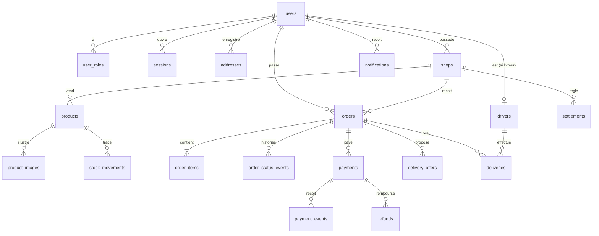
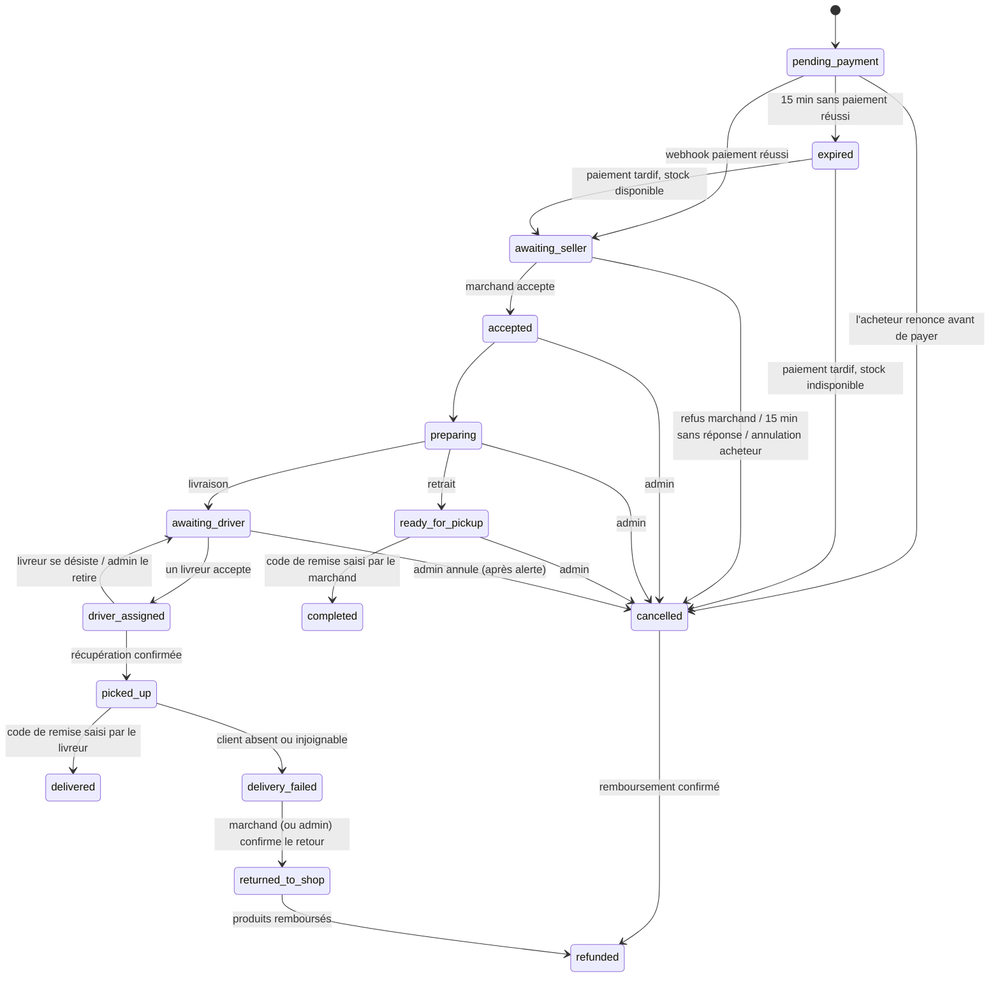
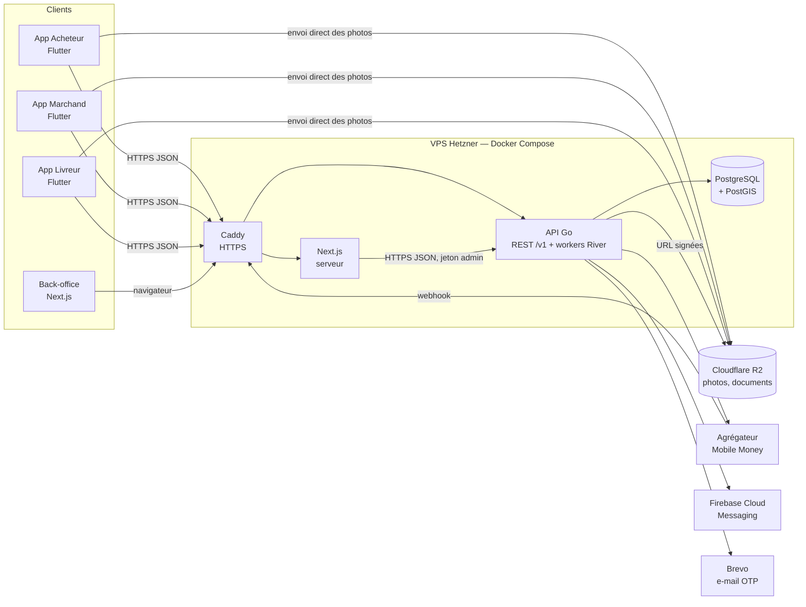

# ARCHITECTURE

Comment ivia est construit. Le résumé indispensable (stack, règles non négociables) est dans
`AGENTS.md` ; chaque choix structurant a son ADR dans `docs/decisions/`.

## Stack technique

Versions vérifiées le 2026-10-30.

| Couche | Choix | Version |
|---|---|---|
| Backend | Go, bibliothèque standard (`net/http`, `log/slog`), monolithe modulaire | Go 1.27 |
| Accès aux données | `pgx/v5` (pool) + `sqlc` (SQL → Go typé) | pgx 5.11, sqlc 1.31 |
| Migrations | `goose` (fichiers SQL embarqués dans le binaire) | 3.29 |
| Tâches de fond | `River` (file de tâches stockée dans PostgreSQL) | 0.50 |
| Base de données | PostgreSQL + PostGIS (`postgis/postgis:18-3.6-alpine`) | PG 18, PostGIS 3.6 |
| Recherche | PostgreSQL : plein texte, `pg_trgm`, `unaccent`, PostGIS pour la distance | — |
| Apps mobiles (×3) | Flutter, Dart pub workspace ; Riverpod, go_router, dio | Flutter 3.47, Dart 3.13, flutter_riverpod 3.4, go_router 18.1, dio 5.11 |
| Back-office | Next.js (App Router), React, TypeScript, Tailwind CSS | Next 16.4, React 19.3, Tailwind 4.3, Node 24 LTS |
| Notifications push | Firebase Cloud Messaging (`firebase_messaging`) | 17.0 |
| Cartes | Google Maps SDK mobile (`google_maps_flutter`), itinéraire ouvert dans l'app Google Maps | 2.19 |
| E-mail (OTP) | Brevo (API transactionnelle) | — |
| Paiement | Agrégateur Mobile Money (Flooz, T-Money), **à choisir** — voir ADR 0007 | — |
| Fichiers | Cloudflare R2 (compatible S3), envoi direct par URL signée | — |
| Erreurs | Sentry (Go, Flutter, Next.js) | sentry_flutter 10.2, @sentry/nextjs 11.10 |
| Hébergement | VPS Hetzner (UE) + Docker Compose + Caddy (HTTPS) | — |

## Modèles de données

Montants en **FCFA entiers** (`bigint`, suffixe `_xof`). Identifiants `uuid`. Horodatages
`timestamptz`. Positions en `geography(Point, 4326)`. Une table appartient à un seul module.



| Module | Tables | Points clés |
|---|---|---|
| auth | `otp_codes`, `sessions` | Code et jeton stockés **hachés** ; tentatives limitées ; sessions révocables |
| users | `users`, `user_roles`, `addresses`, `device_tokens` | `email` et `phone` uniques ; rôles cumulables ; `privacy_consent_at` daté par le serveur à la première acceptation de la politique de confidentialité. Profil complet = prénom, téléphone et consentement (requis pour commander ou postuler comme livreur) |
| geo | `neighborhoods` | Quartiers de Lomé (nom, polygone optionnel) |
| shops | `shops`, `shop_categories` | Statut `pending_review` → `published` / `suspended` ; position obligatoire ; catégorie de boutique obligatoire à la création (liste propre au module : le catalogue dépend déjà des boutiques) |
| catalog | `categories`, `products`, `product_images` | `parcel_size` (`small`/`medium`/`large`), `stock_mode` (`tracked`/`untracked`), colonne `tsvector` pour la recherche |
| stock | `stock_levels`, `stock_movements` | Quantité disponible dans `stock_levels` (et non dans `products`, pour qu'aucun autre module n'écrive dans les tables du catalogue), `CHECK (quantity >= 0)` : survente impossible ; journal des mouvements en ajout seul, écrit dans la même transaction |
| cart | `carts`, `cart_items` | Un panier par acheteur, lié à une seule boutique |
| orders | `orders`, `order_items`, `order_status_events` | Copie du prix, du nom et de la commission à la commande ; historique des statuts **en ajout seul** ; code de remise en clair (affiché à l'acheteur) + compteur d'essais (5 max) |
| payments | `payments`, `payment_events`, `refunds` | `payment_events` garde chaque événement du prestataire (unique par prestataire et identifiant : idempotence) ; `payment_events` et `refunds` sont en ajout seul (trigger). Un remboursement n'est écrit dans `refunds` qu'une fois son résultat connu ; l'état « en cours » est porté par `payments.status = 'refund_pending'`. Statuts d'un paiement : `pending`, `succeeded`, `failed`, `expired`, `refund_pending`, `refunded` ; un paiement reçu pour une commande déjà payée est marqué `is_duplicate` et remboursable. Ces trois tables et `settlements` forment la trace financière |
| delivery | `drivers`, `driver_documents`, `delivery_offers`, `deliveries` | Index uniques partiels : une seule `delivery` active **par commande** et **par livreur** |
| notifications | `notifications` | Liste consultable dans les apps + envoi push |
| settlements | `settlements`, `settlement_lines` | Relevé par boutique et période (fuseau `Africa/Lome`) des commandes remises : net = produits − commission (les frais de livraison restent à la plateforme). Une commande n'entre que dans un relevé (`settlement_lines.order_id` unique) ; un relevé réglé est figé (trigger). Une commande remise n'est jamais remboursée par la machine à états : aucune déduction n'est donc nécessaire |
| search | vues `search_products`, `search_shops` | Lecture seule du catalogue publié ([ADR 0009](decisions/0009-recherche-vues-lecture-seule.md)) |
| uploads, reports | — | Pas de table : URL signées d'envoi de fichiers ; indicateurs calculés par les modules propriétaires des données |
| admin | `settings`, `admin_audit_log` | Commission, barème et coefficient de distance, délais ; journal **en ajout seul** de chaque action admin (qui, quoi, quand, avant/après) |

**Cycle de vie d'une commande** (codes utilisés dans le code et l'API) :



- `cancelled` après paiement et `returned_to_shop` placent la commande dans la **file de
  remboursement** du back-office. `expired` sans paiement ne demande aucun remboursement.
- Le stock réservé est rendu à `expired`, `cancelled` et `returned_to_shop`.
- `accepted`, `preparing` et au-delà : seul l'admin peut annuler.
- La table des transitions permises et de leurs auteurs est dans `backend/internal/orders/statemachine.go`
  (testée transition par transition). Un paiement reçu pour une commande annulée avant paiement
  l'ajoute à la file de remboursement (événement `cancelled → cancelled` dans l'historique).
- Code de remise : 5 essais ; chaque mauvais essai est compté même si la requête échoue, puis le code
  est bloqué jusqu'au déblocage par un admin (journalisé).

Toute transition passe par une seule fonction du module `orders`, qui vérifie qu'elle est permise
(machine à états), l'écrit dans `order_status_events` avec son auteur, et crée les tâches qui en
découlent (notifications, minuteries) dans la même transaction.

## Architecture générale



- **Un seul backend, une seule base.** Aucune application ne parle à la base : tout passe par
  l'API REST `/v1`, y compris le back-office (son serveur Next.js appelle l'API).
- **Monolithe modulaire** : `backend/internal/<module>/` avec trois couches (handlers HTTP →
  service métier → store sqlc). Un module n'utilise **jamais** les tables d'un autre : il appelle
  son service. Les dépendances entre modules vont dans un seul sens (ex. `orders` → `catalog`,
  `payments` → `orders`, `delivery` → `orders`, jamais l'inverse) ; les réactions à un événement
  passent par des tâches River (ex. `orders.status_changed`, traitée par `delivery`).
- **Transactions partagées** : la transaction en cours voyage dans le `context.Context`
  (`database.DB.InTx`) ; un service appelé pendant la transaction d'un autre y participe. Une
  commande, sa réservation de stock, son historique, ses notifications et ses tâches de fond sont
  ainsi écrits atomiquement sans qu'un module touche aux tables d'un autre.
- **Suppression de compte** : le module `users` orchestre ; les autres modules s'y branchent par
  des interfaces (`DeletionGuard` pour refuser, `DeletionHook` pour effacer leurs données).
- **Contrat d'API** : `backend/api/openapi.yaml` décrit chaque route. Les types TypeScript du
  back-office en sont générés (`openapi-typescript`) ; le client Dart est écrit à la main dans
  `mobile/packages/api_client`.
- **Tâches de fond (River)**, dans le même processus que l'API au MVP : expiration des
  propositions de livraison (45 s) et passage au livreur suivant, alerte admin après 5 livreurs ou
  20 min, annulation des commandes sans réponse du marchand (15 min), expiration des paiements en
  attente (15 min), revérification par API des paiements dont le webhook n'est pas arrivé, envoi
  des notifications.
- **Temps réel** : pas de WebSocket au MVP. Notifications push + rafraîchissement périodique des
  écrans actifs (proposition de mission, suivi de commande).
- **App livreur en service** : quand le livreur est disponible ou en mission, l'app tourne en
  service de premier plan Android (notification permanente). Elle interroge l'API toutes les
  10 s pour les propositions — le push ne suffit pas, car les surcouches Tecno, Infinix ou Xiaomi
  coupent souvent les apps en arrière-plan — et envoie sa position toutes les 30 s. Aucune
  position n'est collectée hors service. L'attribution n'utilise que les positions de moins de 2 min.
- **Distance et frais** : distance à vol d'oiseau (PostGIS) boutique → adresse × coefficient
  réglable (1,3 par défaut) ; aucun appel à une API d'itinéraire payante.

**Structure du dépôt**

```
backend/
  cmd/api/                 point d'entrée (API + workers)
  cmd/manage/              administration : grant-admin, seed-dev, migrate
  internal/<module>/       auth, users, geo, shops, catalog, stock, search, cart, orders,
                           payments, delivery, notifications, settlements, admin, uploads, reports
                           (queries.sql → store/ généré par sqlc ; service ; handler ; jobs)
  internal/app/            assemblage des modules (serveur, ligne de commande, tests de bout en bout)
  internal/platform/       config, base (transactions par contexte), HTTP, River, stockage R2,
                           erreurs, validation, limitation de débit
  db/migrations/           migrations goose (SQL)
  api/openapi.yaml         contrat de l'API
mobile/                    Dart pub workspace
  apps/buyer, apps/seller, apps/driver
  packages/api_client      appels HTTP, modèles, gestion du jeton
  packages/app_core        session, connexion par code, champs communs (spec 004)
  packages/ui              thème et composants partagés
admin/                     back-office Next.js
infra/                     docker-compose de production, Caddyfile, sauvegardes
```

## Authentification et autorisations

- **Connexion sans mot de passe par OTP** ([ADR 0006](decisions/0006-authentification-otp-sessions.md)).
  `POST /v1/auth/otp` envoie un code à 6 chiffres via le canal actif (`email` au lancement, puis
  `whatsapp`, `sms` en secours) ; `POST /v1/auth/verify` renvoie un **jeton de session opaque**.
  - Code haché, valable 10 min, 5 essais maximum, 1 demande par minute et 10 par jour par
    destinataire. Plafond par adresse IP volontairement élevé : les opérateurs mobiles font
    partager une même IP à beaucoup de clients.
  - Jeton : 32 octets aléatoires, haché (SHA-256) en base, révocable, envoyé en `Authorization: Bearer`.
  - Mobile : jeton dans le stockage sécurisé du téléphone. Back-office : jeton dans un cookie
    `httpOnly`, `Secure`, `SameSite=Lax`, jamais lisible par le JavaScript du navigateur.
- **Rôles** dans `user_roles`. `buyer` est donné à l'inscription. `seller` est ajouté quand
  l'utilisateur crée une boutique : elle reste invisible tant que l'admin ne l'a pas validée.
  `driver` et `admin` ne sont **attribués que par un admin**.
- **Contrôle d'accès dans le backend, à deux niveaux** :
  1. middleware de route : rôle requis (`requireRole("seller")`) ;
  2. service : propriété de la ressource (le marchand ne voit que les commandes de **ses** boutiques,
     le livreur que **ses** missions, l'acheteur que **ses** commandes).
  Un refus renvoie 404 plutôt que 403 sur une ressource d'un autre utilisateur.
- Un livreur suspendu ou une boutique suspendue perd l'accès aux actions correspondantes
  immédiatement (vérifié à chaque requête, pas seulement à la connexion).
- **Données visibles entre acteurs** : le livreur voit le prénom, le numéro et l'adresse de
  l'acheteur **uniquement pendant sa mission** ; le marchand voit le prénom de l'acheteur, jamais
  son numéro ni son adresse.
- **Suppression de compte** : sessions révoquées, nom, e-mail, téléphone, adresses et jetons
  push effacés ou remplacés par des valeurs anonymes ; commandes, paiements et relevés conservés.
  Refusée tant qu'une commande ou une mission est en cours.
- **Actions admin** : chacune est écrite dans `admin_audit_log` dans la même transaction que
  l'action elle-même.

## Intégrations externes

| Service | Usage | Clé / variable | Coût | Limite à surveiller |
|---|---|---|---|---|
| Agrégateur Mobile Money (à choisir) | Paiement Flooz / T-Money, webhooks, remboursements | `PAYMENT_*` | Commission ~1,5–2,2 % (à confirmer) | Ouverture de compte (RCCM, NIF) ; mode test |
| Brevo | E-mail OTP | `BREVO_API_KEY` | Gratuit | 300 e-mails / jour |
| WhatsApp Business (Meta Cloud API) | OTP, plus tard | `WHATSAPP_*` | Payé par message d'authentification | Vérification de l'entreprise et modèle approuvé |
| Firebase Cloud Messaging | Notifications push | Compte de service Firebase | Gratuit | — |
| Google Maps SDK (Android/iOS) | Cartes dans les apps | Clé restreinte aux apps | Gratuit pour le SDK mobile | Ne pas utiliser les API payantes (Directions, Geocoding) côté serveur |
| Cloudflare R2 | Photos produits/boutiques, documents livreurs | `R2_*` | Gratuit jusqu'à 10 Go | Documents livreurs dans un bucket **privé** |
| Sentry | Erreurs backend, apps, back-office | `SENTRY_DSN` | Gratuit (offre de base) | Volume d'événements |

Chaque intégration est derrière une interface Go (`PaymentProvider`, `OTPSender`, `PushSender`,
`ObjectStore`) avec une **implémentation factice** pour le développement local et les tests.

## Environnements et déploiement

| Environnement | Où | Base | Paiement / e-mail |
|---|---|---|---|
| local | Machine du développeur, `docker compose` | PostGIS en conteneur, auth `trust` sur 127.0.0.1 | Faux prestataire, e-mails affichés dans les logs |
| staging | Petit VPS séparé (mis en place à l'intégration du paiement) | Base séparée | Mode test du prestataire |
| production | VPS Hetzner (UE) | Base de production, mot de passe + accès réseau interne uniquement | Comptes réels |

- **Déploiement** (`infra/`, mode d'emploi dans `infra/README.md`) : la CI construit les images Docker (API, back-office) à chaque fusion sur `main`
  et les publie sur GitHub Container Registry ; le déploiement sur le VPS se fait par
  `docker compose pull && docker compose up -d`. Les migrations goose s'exécutent au démarrage de l'API.
- **Retour arrière** : redéployer l'image précédente (tag = SHA du commit). Les migrations doivent
  rester compatibles avec la version précédente du code (ajouter, puis supprimer dans une version
  ultérieure).
- **Sauvegardes** : `pg_dump` chaque nuit vers R2 (30 jours conservés) + instantané du VPS ;
  **restauration testée chaque mois** sur staging.
- **Secrets** : fichier `.env` sur le VPS (droits restreints), jamais dans git ; en CI, secrets
  GitHub.
- **Apps mobiles** : Android publié en premier sur le Play Store (test interne → production)
  avec un compte développeur **organisation** (évite la phase de 14 jours avec 12 testeurs imposée
  aux comptes personnels) ; iOS après le MVP. L'URL de l'API est fixée à la compilation
  (`--dart-define`). L'app livreur déclare l'usage de la localisation et du service de premier plan
  dans la Play Console.
- **Photos** : redimensionnées et débarrassées de leurs métadonnées (dont la position GPS) dans
  l'app avant l'envoi.

## Observabilité

- **Logs** : JSON (`log/slog`) avec un identifiant de requête, collectés par Docker ; jamais de
  code OTP, jeton, numéro complet ou donnée de paiement dans les logs.
- **Erreurs** : Sentry sur l'API, les trois apps et le back-office.
- **Santé** : `/health` (processus vivant) et `/ready` (base joignable) surveillés par un service
  de disponibilité gratuit, avec alerte e-mail.
- **Indicateurs métier** (requêtes SQL dans le back-office) : commandes payées par jour, délai
  d'attribution d'un livreur, délai prête → livrée, taux d'annulation, paiements en attente depuis
  plus de 15 minutes.

## Choix techniques

- [ADR-0001](decisions/0001-stack-go-flutter-postgresql.md) — Stack : Go (stdlib) + Flutter + PostgreSQL 18 (pgx)
- [ADR-0002](decisions/0002-trois-apps-flutter-workspace.md) — Trois apps Flutter dans un pub workspace avec paquets partagés
- [ADR-0003](decisions/0003-back-office-nextjs.md) — Back-office en Next.js, client de l'API comme les apps
- [ADR-0004](decisions/0004-monolithe-modulaire-sqlc-goose.md) — Monolithe modulaire, sqlc pour les requêtes, goose pour les migrations, PostGIS
- [ADR-0005](decisions/0005-taches-de-fond-river.md) — Tâches de fond avec River (file dans PostgreSQL)
- [ADR-0006](decisions/0006-authentification-otp-sessions.md) — Connexion par OTP multi-canal et sessions opaques
- [ADR-0007](decisions/0007-paiement-mobile-money.md) — Paiement derrière une interface, agrégateur à choisir (proposé)
- [ADR-0008](decisions/0008-hebergement-vps-hetzner.md) — Hébergement sur VPS Hetzner avec Docker Compose, fichiers sur R2
- [ADR-0009](decisions/0009-recherche-vues-lecture-seule.md) — Recherche par vues SQL en lecture seule du catalogue publié

## Points d'attention

Risques acceptés ou à surveiller, issus du stress-test du 2026-10-30.

**Chemin critique hors code**
- Prestataire de paiement non choisi ; le **transfert vers un numéro par API (payout)** est un
  critère éliminatoire, sinon tous les remboursements se font à la main.
- Démarches : société (RCCM, NIF), compte Google Play organisation (D-U-N-S), conformité BCEAO de
  l'encaissement pour compte de tiers, déclaration à l'autorité togolaise de protection des
  données, validation Meta pour WhatsApp. Suivies dans `TASKS.md`.

**Risques techniques acceptés**
- Un seul VPS de production (API, base, back-office) : panne = service indisponible. Compensé par
  les sauvegardes externes (R2) et une restauration testée chaque mois.
- Numéro de téléphone non vérifié tant que l'OTP passe par e-mail : au passage à WhatsApp, chaque
  utilisateur devra vérifier son numéro ; un numéro revendiqué par deux comptes sera arbitré par
  l'admin.
- L'e-mail est peu utilisé par une partie du public : friction à l'inscription au lancement.
- Les notifications push sont peu fiables sur certains Android : l'app livreur interroge l'API
  et n'est fiable que si le livreur garde le service actif.
- La distance à vol d'oiseau sous-estime certains trajets : coefficient réglable, à ajuster avec
  les premières livraisons.
- River pré-1.0 : version figée, notes lues avant chaque mise à jour.
- Contrat OpenAPI tenu à la main : il peut diverger du code ; la revue de chaque route vérifie
  qu'il est à jour.

**Charge de travail**
- Deux développeurs, six mois, quatre interfaces : risque principal du projet. Le backlog est
  ordonné pour pouvoir lancer une version « retrait seulement » vers le 4e mois.

**Simplifications retenues**
- Pas de journal comptable séparé : `payments`, `payment_events`, `refunds` et `settlements`
  suffisent à tracer l'argent.
- Une mission à la fois par livreur.
